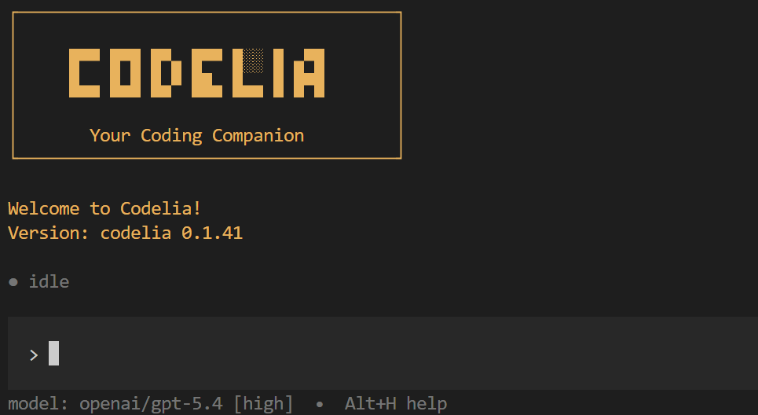

# Codelia



Codelia is a terminal-first coding agent with a native TUI.
It helps you inspect, edit, and reason about code directly in your repository.

The product ships through the `codelia` CLI, while the main interactive experience is the TUI.
Under the hood, a TypeScript runtime and a Rust TUI communicate over JSON-RPC.

> **Beta (`0.x`)** — Actively developed with primary support for macOS and Linux terminals. Native Windows sandboxing and some workflow features are still in progress; see [Known limitations](#known-limitations).

## Provider support

Current built-in providers:
- `openai` (API key or OAuth with ChatGPT Plus/Pro)
- `anthropic` (API key only)
- `openrouter` (API key only)
- `google` (API key only; native Gemini chat and image generation)
- `deepseek` (API key only; native `deepseek-flash` and `deepseek-v4-pro`)
- `moonshot` (API key only; native Kimi K3 / K3.1 support)
- `zai` (API key only; native GLM-5.x support)
- `xai` (API key only; native Grok 4.x Responses API support)

You can also register custom named HTTP Responses API endpoints in `config.json` (see [`docs/responses-providers.md`](docs/responses-providers.md)).

## Security & sandbox note

Codelia defaults to `workspace-write` sandbox mode (`readonly | workspace-write | full-access`) paired with command approval (or opt-in per-workspace Auto approve).

- Confined `shell` execution uses OS-level isolation where qualified: Seatbelt (or MXC via `CODELIA_MAC_SHELL_BACKEND=mxc` on arm64) on macOS and packaged MXC Bubblewrap (or rootless gVisor via `CODELIA_LINUX_SHELL_BACKEND=gvisor`) on Linux.
- Ordinary local files within the backend's readable scope remain readable unless restricted in `projects.json` (`protected_paths`); Codelia credentials are protected from reads and writes, and Codelia authority/config settings are write-protected by default.
- Native Windows MXC containment is still under evaluation: confined shell launches are unavailable in the local CLI/TUI on native Windows (explicit `--sandbox-mode full-access` runs outside OS isolation).

See [`docs/command-approval.md`](docs/command-approval.md) ([日本語ガイド](docs/command-approval.ja.md)) for sandbox boundaries and approval rules.

## Quickstart

Install the published CLI package globally:

```sh
npm install -g @codelia/cli
```

Update to the latest version:

```sh
codelia update
# or: npm update -g @codelia/cli@latest
```

Launch the TUI:

```sh
codelia
```

Choose a provider and model, then follow the [authentication setup guide](docs/getting-started.md#2-set-up-provider-auth).

Then type a request such as:

```text
Find the failing test and explain the root cause.
```

## What you can do

- Work with a coding agent directly in your terminal
- Resume previous sessions with `--resume`
- Use slash commands such as `/help`, `/model`, `/skills`, and `/mcp`
- Add repo-specific instructions with `AGENTS.md`
- Package reusable workflows as Skills
- Connect external tool servers through MCP
- Run a one-shot non-interactive request with `codelia --prompt`

## TUI workflow

A typical session looks like this:

1. Start `codelia`
2. Type a request in the composer
3. Press `Enter` to send it
4. Watch inline progress, tool activity, and results in the terminal
5. Continue the same thread with follow-up prompts
6. Resume later with `codelia --resume`

Useful startup commands:

```sh
codelia
codelia --resume
codelia --resume <session_id>
codelia --initial-message "Review the latest changes"
codelia --diagnostics
codelia --debug
```

## Docs

### User docs

- Index: [`docs/README.md`](docs/README.md)
- Start here: [`docs/getting-started.md`](docs/getting-started.md)
- Sandbox & command approval: [`docs/command-approval.md`](docs/command-approval.md) · [日本語ガイド](docs/command-approval.ja.md)
- TUI basics: [`docs/tui-basics.md`](docs/tui-basics.md)
- Image generation & preview: [`docs/image-generation.md`](docs/image-generation.md)
- Decisions: [`docs/decisions.md`](docs/decisions.md)
- Session storage & retention: [`docs/session-storage.md`](docs/session-storage.md)
- Themes: [`docs/themes.md`](docs/themes.md)
- CLI reference: [`docs/reference/cli.md`](docs/reference/cli.md)
- Config reference: [`docs/reference/config.md`](docs/reference/config.md)
- Environment variables: [`docs/reference/env-vars.md`](docs/reference/env-vars.md)
- AGENTS.md: [`docs/agents-md.md`](docs/agents-md.md)
- Skills: [`docs/skills.md`](docs/skills.md)
- MCP: [`docs/mcp.md`](docs/mcp.md)
- Custom Responses endpoints: [`docs/responses-providers.md`](docs/responses-providers.md)
- DeepSeek guide: [`docs/deepseek.md`](docs/deepseek.md)

### Developer / internal docs

- Docs index: [`dev-docs/README.md`](dev-docs/README.md)
- Architecture & dependency graph: [`dev-docs/reference-architecture.md`](dev-docs/reference-architecture.md)
- Specs: [`dev-docs/specs/`](dev-docs/specs/)
- npm publish runbook: [`dev-docs/npm-publish.md`](dev-docs/npm-publish.md)

## Local development

Requirements:
- [Bun](https://bun.sh/)
- Rust toolchain (`cargo`) for the TUI build/run path

Install dependencies:

```sh
bun install
```

Run the TUI directly from this repo:

```sh
bun run tui
```

### Development API keys

Provide API keys (`OPENAI_API_KEY`, `ANTHROPIC_API_KEY`, `GEMINI_API_KEY`, `OPENROUTER_API_KEY`, etc.) through environment variables—either exported in your shell or injected via your preferred secret manager. Keep local secret/env files (such as `.env` or `.infisical.yaml`) out of version control. Commands that do not invoke live providers run directly without keys.

Useful development commands:

| Command | Description |
|---|---|
| `bun run typecheck` | Type checking |
| `bun run test` | Run tests |
| `bun run fmt` | Format with Biome |
| `bun run check:deps` | Dependency hygiene |
| `bun run check:versions` | Workspace version sync |

## Repository layout

- `packages/core` — agent loop, history, compaction, and provider adapters
- `packages/protocol` — JSON-RPC wire catalog and schemas
- `packages/storage` — session logs, checkpoints, credential/keychain storage, and artifact stores
- `packages/runtime` — runtime server, tools, permissions, sandbox, and MCP
- `crates/tui` — Rust TUI client
- `packages/cli` — `codelia` CLI entrypoint
- `docs/` — user-facing documentation
- `dev-docs/` — developer/internal documentation

## Known limitations

- Native Windows MXC containment and local subagent execution are still under evaluation: confined shell launches are unavailable in the local CLI/TUI on native Windows (explicit `--sandbox-mode full-access` runs outside OS isolation).
- Snapshot-based file rollback, lifecycle hooks, LSP/IDE extensions, hosted/remote worker isolation, and automatic retention GC for generated image artifacts remain planned work.
