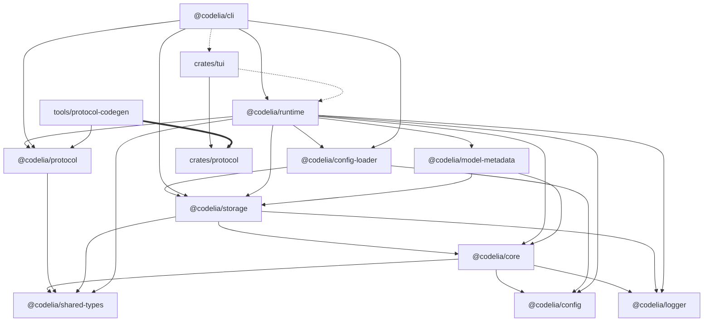

# codelia Architecture Overview

This document summarizes the core architecture of codelia and the package
boundaries used in this monorepo. For an illustrated walkthrough (open locally
in a browser), see [`architecture.html`](./architecture.html).

Image generation follows the existing dependency arrows: shared-types owns
`ImageArtifactRef`/metadata; core owns reference ContentParts, request-only
materialization and compaction references; storage validates/persists immutable
originals and fixed model-view sidecars (lazy `sharp` encoder); runtime composes API auth/routes/tools, config and RPC; protocol
owns the image settings/artifact transport contracts; TUI owns display. No new
workspace dependency edge or cross-package deep import is required. `sharp` is an
external storage dependency, loaded only when preparing an eligible new view. See
[implemented image slice](specs/image-generation.md#11-implemented-public-api-slice).

---

## 1. Core loop (mental model)

The agent is a simple loop:

```
User
  │
  ▼
Agent.run/runStream
  │  (messages + tools)
  ▼
LLM (BaseChatModel.ainvoke)
  │  └─ messages[] (assistant/reasoning/tool_calls in sequence)
  ▼
Tool execution
  │  └─ ToolMessage
  ▼
Agent loop (repeat)
  │
  └─ Final response or done signal
```

---

## 2. Package responsibilities

- `@codelia/core`
  - Agent loop, message history, tools, context management, and provider adapters.
- `@codelia/shared-types`
  - Cross-boundary stable types shared by core/protocol/runtime.
- `@codelia/protocol`
  - Core-independent UI/runtime wire protocol: Zod schemas and the method
    catalog (`src/catalog.ts`). The runtime validates params against the
    catalog at run time; `tools/protocol-codegen` (`bun run generate:protocol`)
    derives the committed JSON Schema, method table, shared fixtures and
    `crates/protocol/src/generated.rs`. See
    [protocol-codegen.md](specs/protocol-codegen.md).
- `@codelia/config`
  - Config schema, parsing, and defaults.
- `@codelia/config-loader`
  - Config file discovery/load/merge helpers.
- `@codelia/logger`
  - Shared logging helpers (stderr logger and `CODELIA_DEBUG=<topics>` /
    `CODELIA_DEBUG_DIR` helpers). It has no workspace dependencies, so core and
    storage may use it.
- `@codelia/runtime`
  - JSON-RPC runtime server that connects UI/TUI to core tools and agents.
- `@codelia/storage`
  - Session logs and resume state persistence.
- `@codelia/model-metadata`
  - Model metadata resolution and registry helpers.
- `@codelia/cli`
  - Product entrypoint that launches TUI/runtime paths (no core/tool implementation).
- `crates/protocol`
  - Shared Rust wire types generated from `@codelia/protocol` and JSON-RPC envelope helpers.
- `crates/tui`
  - Rust TUI client that drives the runtime. It follows a pragmatic TEA loop
    (`Msg` -> `update` -> `AppState`, with `RuntimeTx` sends and `Effect`
    side effects; see [tui-tea-architecture.md](specs/tui-tea-architecture.md))
    and sends and decodes protocol messages only through `crates/protocol`.

---

## 3. Context management

- Tool output cache trims large tool outputs and keeps references for replay.
- Compaction summarizes history when context usage is high.
- Usage tracking aggregates token usage across runs.

---

## 4. Module dependency diagram

Dependency direction:
- `A --> B` means "A depends on B".
- `A -.-> B` means "A spawns/calls B as a process" (not a build-time dependency).
- `A ==> B` means "B contains committed code generated from A".

Workspace edges match each package's `package.json`; `bun run check:deps`
checks declared dependencies and deep imports in CI.



`storage` and `model-metadata` depend on `core` for its storage and metadata
service interfaces (`src/di/`, `src/types/`), which they implement.
