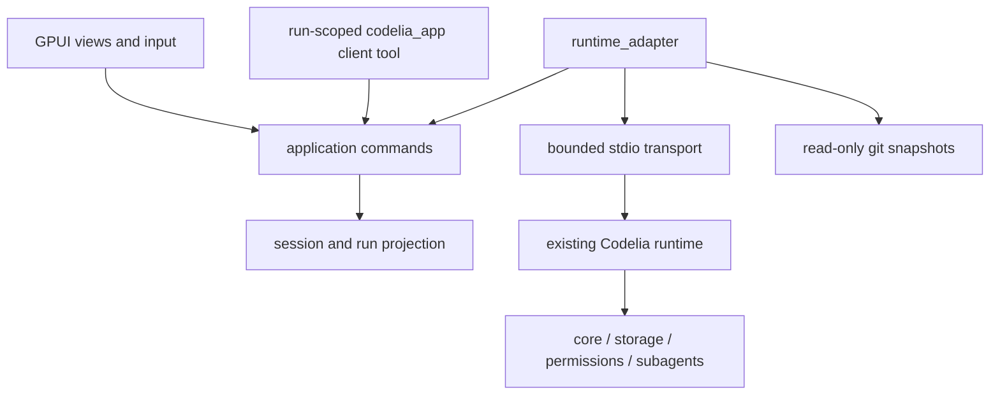

# Native GPUI desktop

Status: **Experimental / Partial**, Mac-first, 2026-10-06.

This is a new shell in `crates/desktop`, not a continuation of the old Electrobun GUI. Runtime, core, permissions, storage and subagent orchestration remain Codelia's existing implementation. Existing worktrees and uncommitted work are preserved.

## Toolkit and reference evidence

“GPUI toolkit” is implemented using Longbridge **GPUI Kit** (`gpui-kit = "=0.7.1"`). Its [official getting-started guide](https://gpui-kit.com/docs/getting-started/) identifies GPUI, Base, Component and assets as the bundled layers. The kit includes the macOS font backend. [Release 0.7.1](https://github.com/longbridge/gpui-kit/releases/tag/v0.7.1) and `Cargo.lock` pin the actual dependency graph. The GPUI snapshot needs Rust 1.95.0; 1.93.1 failed on `cold_path`. The repository's TUI toolchain/default is unchanged.

The [Claude Code desktop documentation](https://code.claude.com/docs/en/desktop) describes opening review from a diff indicator, optional rearrangeable panes, and explicit permission decisions. These inform optional Changes inspection and contextual approval; this shell does not claim Claude's comment/review/pane feature parity. GPUI Kit's [MessageScroller](https://gpui-kit.com/component/message-scroller/) provides variable-height virtualization and follow/jump-to-latest behavior.

A compact monochrome design concept guided the shell. Historical compact UI checks exist, but current connected native approval/Stop/child/input/model-switch flows, OS IME and pixels remain unverified. Headless interaction coverage does not close those gates; see `crates/desktop/VALIDATION.md`.

## Dependency direction



- `main.rs`: platform setup and validated launch resolution; `launch.rs`: normal workspace/runtime options and optional bounded native QA resources.
- `app.rs`: GPUI entities, native folder picker, event pump and command dispatch.
- `ui/`: shell, sidebar, transcript, approval/input and Git inspector; `tasks_view.rs`: selected child result.
- `application.rs`: pure common commands. No GPUI, process creation or filesystem writes.
- `state.rs`, `state/notifications.rs`: run/session/request projection and ownership.
- `runtime_adapter.rs`, `transport.rs`, `git.rs`: infrastructure.
- No second orchestrator, HTTP control server or external-agent control API. Optional protocol additions cover UI request cancellation, transient text and local worktree management; legacy clients remain compatible. Worktree creation is owned by the common runtime application service, with once-only confirmation and no agent/setup launch.

## Implemented flows

- Native workspace folder selection; one runtime per workspace, at most eight open workspaces. Switch without reassigning an in-flight run. Existing Git worktrees can be opened as workspaces. The bounded project-worktree list exposes status/refresh and explicit committed-HEAD creation through the shared runtime service; [worktree contract](worktrees.md) records the implemented subset.
- New unsent draft, cached session switching, persisted session list and bounded history replay. Draft text and virtual scroll state are per workspace/thread. History replay is serialized against that workspace's live run because replay lacks a session envelope. Drafts become runtime session IDs on first accepted run.
- `run.start`, live `agent.event` text/reasoning/tools, context notifications and real terminal run status. Tool arguments, permission preview and actual result/error are expandable; final text preserves tool chronology. Copy/selectable text and Japanese text rendering use native components.
- Confirmation (allow once / deny), prompt (secret masking), single/multi pick and cancel. Requests settle once. Desktop negotiates `supports_ui_request_cancel`, closes only matching cancelled request IDs, and preserves child approval across parent completion/Stop. Structured `task_id` identifies the child and provides result inspection. Desktop never sets remembered allow rules. Runtime remains the policy authority.
- Parent-turn Stop, including Stop before run ID acknowledgement; duplicate-send guard; provider error, explicit editable retry, disconnect/reconnect with no automatic replay.
- Cmd-Q/window close request asynchronous cleanup of owned runtimes before application exit. The UI shows closing progress while the runtime handles its existing task shutdown. The owned-runtime fallback timeout is 40 seconds; final native quit/child cleanup remains unverified.
- Existing Codelia `task_spawn`/`task_list`/`task_status`/`task_cancel`/`task_send_message` remain model tools. Live child summaries are shown in sidebar; selecting one opens actual `task.status` output and child-specific cancellation. Parent Stop does not cancel admitted children. Child results are not presented as independently resumable child chat views.
- Internal agents receive the per-run `codelia_app` client tool: `list_threads`, `create_thread`, `select_thread`, `status`, `open_changes`, `list_worktrees`, `create_worktree`. Worktree intents return requested/cached status, require exact user confirmation and never switch the human workspace automatically. UI and tool share the same application commands and workspace-owned inspector state; background commands cannot open another workspace's panel. Connected active run identity is mandatory; Stop-pending calls fail. Action-specific inputs are validated locally, because runtime client adapters parse JSON without validating the supplied JSON Schema. The tool cannot approve requests, change auth, send prompts, delete data or dispatch arbitrary RPC.
- Read-only `git status`, tracked diff against HEAD (including staged and unstaged), and worktree list. Untracked paths are listed; their file content is not invented as a diff. Output is bounded to 1 MiB and loaded off the UI thread. Diff `+`/`-` markers remain readable independently of color.

## Thread and checkout consistency

Draft sends require negotiated explicit `new_session`; omission remains legacy runtime continuation. Guarded runs carry observed checkout identity and reject foreign/replaced saved sessions before model work. Source replacement during held worktree approval is rejected. Restored model overrides rebuild the cached Agent when needed; exact bound-session comparison prevents model changes to an inactive selected thread. Event-store initialization failure leaves no admitted run.

A disconnect preserves in-memory drafts and marks unfinished run/create outcomes interrupted/unknown. Late replies cannot overwrite another conversation or replay a request. Restarted pending/corrupt worktree records remain inspectable unknown observations without journal rewrite or Git re-execution. Acknowledged current drafts now survive app restart through [the local draft store](drafts.md); unacknowledged edits remain outside the crash guarantee. All-tool side-effect reconciliation and native OS restart/input QA remain open.

## Current draft recovery

Nonempty composer drafts save locally by physical project/checkout/thread identity through a background worker. Idle input coalesces for 250ms; continuous typing saves at two-second intervals. Only the current bounded record is retained. Native Save/Clear never logs text or sends a model request during recovery. Send durably removes its draft before runtime dispatch; Cancel send, failed save/quit and rejected admission retain the correct input. Normal quit waits for current drafts; failures keep the window open with an explicit Quit without saving option. Corrupt/foreign records are preserved and rejected. [Draft contract](drafts.md) records bounds and crash/unknown-outcome limits. Native OS validation remains separate.

## Space and performance policy

The palette is white/black/neutral gray with a small amber approval border. No teal. Normal layout has navigation + conversation; inspector opens only for Changes or a selected child, never both. Sidebar can collapse; with inspector open below 1,000px width navigation is hidden to preserve the conversation. Header status stacks beneath the session title when the available conversation width is below 640px; navigation and Changes use labeled accessible icon controls. At narrow widths selecting navigation closes the inspector to reveal sessions, and Changes has its own close button. Workspace identity is in navigation; model/send/stop stay with composer. Successful tools collapse; failures expand but user fold choice is retained. Copy buttons appear on row hover. No permanent blank inspector or redundant agent cards.

MessageScroller's default 32px inter-row gap is overridden to 4px without reducing font size. Transcript rendering is virtualized. A conversation retains at most 2,500 rows / 4 MiB string data including row metadata; body/detail and child result text are capped at 64 KiB on UTF-8 boundaries, titles at 256 bytes. Event run/tool identifiers over 256 bytes are rejected. Row identity uses event sequence, including hidden context messages. Ordered per-run high-water marks retain 64 recent runs without clearing deduplication after 10,000 events. At most eight persisted transcripts and 64 unsent drafts are cached per workspace; draft text is never evicted. Older transcript content remains in runtime storage. Transport caps frames at 8 MiB and its incoming queue at 256. The event pump redraws only after changes; task summaries poll at one second only while work is active. These are retained-state limits, not a claim of benchmarked peak memory or release performance.

## Model text streaming

The [shared text-stream contract](../model-text-stream.md) now connects an optional awaited provider-neutral model sink, Agent invocation/attempt lifecycle, capability-negotiated runtime delivery and desktop provisional-row projection. Real OpenAI HTTP SSE text arrives before model completion in the isolated loopback test; canonical commit replaces the preview, failed attempts discard it and cancellation drops unfinished rows. Partial events are not persisted; replay stays canonical. This is actual provider text, not simulated typing.

OpenAI WebSocket and other provider transports remain buffered until they implement the same contract. Reasoning and tool arguments are not streamed. Default/legacy SDK and TUI clients remain completion-based. Native pixels/OS streaming interaction remain unverified, and restart-safe side-effect reconciliation is a separate roadmap milestone.

Shell actions include only the two additional FileDiff/X SVG assets alongside Kit defaults. Navigation text is left aligned inside button content. Failed Git observations clear stale results and show unavailable/error rather than a clean working tree. Changes remains optional and can close through its own action or narrow-window navigation.

## Development

From the checkout root:

```sh
bun install --frozen-lockfile
bun run --filter '@codelia/*' build
bun run desktop:build
bun run desktop -- /absolute/workspace/path
```

`rustup toolchain install 1.95.0 --profile minimal --component rustfmt --component clippy` is needed once. Native dependencies are pinned in the crate's lockfile/toolchain file. `bun run desktop:app` packages the debug binary in `crates/desktop/target/Codelia.app`; double-click defaults to this checkout. The local development bundle references source runtime and workspace package builds, requires Bun, and has a local ad-hoc bundle signature and is not a Developer ID signed/notarized standalone distribution. `CODELIA_DESKTOP_RUNTIME_CMD` / `CODELIA_DESKTOP_RUNTIME_ENTRY` can explicitly select the runtime executable/entry. Normal launch reads existing Codelia auth/config; no credential is copied into the app.

macOS may deny a GUI-launched runtime subprocess access to a checkout in Documents even though terminal tests pass. In that case Bun can report `Module not found`; confirm the actual read error before diagnosing IPC. The development bundle still depends on readable source/package builds. Respect the denial without copying protected source or altering security settings to work around it. Standalone runtime packaging remains future distribution work.

Validation commands:

```sh
bun run desktop:test
bun run desktop:test:ui # headless input/layout; no runtime or OS app
cargo +1.95.0 clippy --manifest-path crates/desktop/Cargo.toml --all-targets -- -D warnings
bunx tsc -p crates/desktop/tests/tsconfig.json
bun crates/desktop/tests/runtime-smoke.ts
bun run lint
bun run typecheck
bun run check:deps
bun run check:versions
bun run test
bun run build
```

`runtime-smoke.ts` creates an isolated disposable workspace and synthetic credential, starts the real Codelia runtime plus a deterministic loopback Responses model, and verifies permission deny/allow, actual write, internal client-tool transport, existing child execution, two running children plus parent approval, separate parent/child cancellation, provider error/recovery and history. It makes no paid model call. Native and automated validation results are recorded in `crates/desktop/VALIDATION.md`. `python3 crates/desktop/tests/check-architecture.py` checks the source dependency direction.

## Remaining scope

- Live assistant text is implemented for the OpenAI HTTP path with shared attempt-scoped events. Other transports/providers remain completion-based; native streaming UX and adapter parity need their own validation.
- No file editor/tree, integrated terminal, attachments/image preview, OAuth/settings editor, commit/stage/revert, PR/push/merge/deploy, archive/rename, standalone release package, panel drag-resize, recursive agent tree or external-agent API.
- Child navigation currently inspects task results, not child conversation replay/breadcrumbs. Child approval origin uses typed runtime `task_id`; display names remain runtime-supplied prose. Multiple workspaces can run concurrently; one parent run per workspace is admitted. An older runtime without UI cancellation capability retains legacy parent-terminal clearing behavior.
- Composer drafts and request-specific runtime-answer text survive workspace navigation, not app restart. Runtime-answer drafts are in memory only, tied to workspace/request identity, and removed with request settlement/cancellation/disconnect; intentionally cleared defaults remain cleared and secret fields remain masked. Paid provider/auth behavior is intentionally untested. OS IME composition and final native appearance/stop/retry checks remain open while authorized CUA transport is unavailable; current Mac lock state is unknown.

Native QA packaging uses `bun run desktop:app -- --name "Codelia Native Entry QA" --bundle-id dev.codelia.desktop.native-entry-qa --validation-fixture /tmp/codelia-gpui-native-resume-qa --provider-url http://127.0.0.1:64405/v1` with an existing disposable fixture. Existing QA paths are refused rather than overwritten. The native main reads only bounded validation metadata, retains the same checkout runtime entry, and supplies synthetic XDG/provider options directly to Bun. No shell launcher is the bundle main. Latest package validation is recorded at the end of VALIDATION.md; new-bundle OS interaction remains unverified.

### Missing startup workspace

An absent or unreadable initial workspace leaves an actionable empty window with Open workspace. Polling, Send, input capture and Quit must remain safe before any workspace is admitted. Failed admission starts no runtime or draft worker and never silently substitutes another folder. The 2026-10-07 user-reported Recovery QA crash was a native bounds panic in Desktop::poll after its fixture workspace was absent; this is distinct from runtime/provider connection failures. Its old bundle/resources are preserved as historical evidence.

The continuation's current normal-use development bundle is `crates/desktop/target/Codelia Desktop Continuation.app`, ID `dev.codelia.desktop.continuation`; it has no validation resource or fixture dependency. It uses existing Codelia configuration/auth and automatically starts Bun with this checkout's runtime entry. Actual native launch of the newly fixed bundle remains unverified without native CUA.

### Provider/model recovery and navigation

See [model-selection.md](model-selection.md) for the composer chooser, offline provider catalogs and thread-scoped `run.start.model`, which never writes global/project configuration or authentication. Unsupported configured providers keep the selector visible; shared admission and keyboard Send require a valid model. The user-reported `home` provider was classified in the existing global home config, not invented by the desktop launch adapter; its provenance before this inspection is unknown.

Latest normal development bundle is `crates/desktop/target/Codelia Desktop Updated.app`, ID `dev.codelia.desktop.updated`, built separately from the user's existing app. It has no validation resource. Native opening/connected model-switch pixels have not been verified here. Previous bundles are preserved. Child agents now exclude shell jobs; duplicate folder basenames show distinguishing paths; related worktrees identify current folder/branch and collapse internal details.

Cloud setup and the source-publication acceptance limits are recorded in [cloud handoff](cloud-handoff.md).
