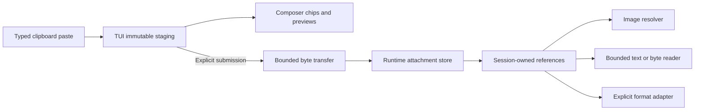

# Pasted images and files

Status: `Partial`. The local TUI, runtime upload and storage, run/Steer admission
and model reader are implemented. Native clipboard acceptance across operating
systems, format-specific extraction, remote SSH transport and blob collection
remain open.

## 1. Product boundary

Users can paste an image or copied files into the composer. Files may contain text
or arbitrary binary data. A file becomes a message attachment with its original
bytes preserved; attachment does not mean that its full contents must be inserted
into the model prompt. Successful attachment also does not imply that a selected
model can understand that file's format.

The primary entry is paste, extending the existing image-paste workflow. A new
slash command is not a prerequisite. `/image <path>` remains a preview command.
The earlier generic `/attach` and automatic UTF-8 expansion are not the selected
design. File-path insertion from the terminal is not itself permission to open a
file: ordinary pasted text remains text.

Current implementation anchors:

- `crates/tui/src/event_loop/input.rs`: `Alt+V` starts a clipboard image or copied-file import; ordinary
  terminal paste routes text into the composer.
- `crates/tui/src/app/util/clipboard/mod.rs`: local clipboard adapters, including
  native file-list reads and the Windows clipboard bridge on WSL.
- `crates/tui/src/app/util/attachments/mod.rs`: nonce-bound composer tokens, cancellable batch import and immutable file staging.
- `packages/runtime/src/image-generation/attachments.ts`: submitted inline images
  become durable image references in the local runtime's image store.
- `packages/runtime/src/environment.ts`: non-local hosts require explicit
  adapters; local filesystem behavior must not leak into embedded hosts.

The SSH runtime transport itself remains planned in `tui-remote-runtime-ssh.md`.
The design must support that boundary without claiming current remote support.

## 2. Input and composer behavior

| Input | Composer behavior | Default model delivery |
| --- | --- | --- |
| Pasted text | Ordinary editable text | Text |
| Clipboard image | Image chip, preview available | Existing vision input when supported |
| Copied PNG/JPEG/WebP/GIF file | Image chip retaining original bytes/name | Vision input when supported |
| Copied text file | File chip with name/type/size | Reference and metadata; bounded reading on demand |
| Copied binary file (including other image formats) | File chip with name/type/size | Reference, metadata and bounded byte reads |

Use the existing explicit clipboard gesture (`Alt+V`) for typed image/file paste.
Prefer a native copied-file list over a redundant bitmap representation of the
same selection, preserving original file bytes. Otherwise use an image bitmap;
if neither is available, leave the composer unchanged with a concise message.
Normal text paste keeps its existing behavior. Plain path strings, file URLs in
text, and terminal drag-and-drop text are not silently promoted to attachments.
An explicit import gesture or a later picker may handle those paths; do not add
a command merely to compensate for an unimplemented clipboard adapter.

The host clipboard adapter returns typed sources, not a shell command string.
Native paths must retain Unicode, spaces, backslashes and UNC roots. No shell
splitting, expansion, command execution, or fetching remote URLs is involved.
Resolve clipboard file handles on the TUI host. WSL adapters must read the bytes
on the host owning the clipboard or explicitly map supported paths; Windows
paths must never be passed blindly to the Linux filesystem.

Import is a background, bounded operation. Each selected batch is validated and
staged atomically before adding ready chips. Show loading/error state without
blocking rendering, run cancellation, or incoming runtime events. Do not submit
a message with partially loaded attachments. Insert a pending marker at the
paste cursor, owned by this draft and batch. Edits around the marker preserve
its position. Resolve each marker in place so two pastes keep their order even
if the second finishes first. Removing the marker, clearing the draft or
switching sessions invalidates that import. Failure removes only that marker.
Removing one chip removes that draft reference. No model request or runtime
upload occurs merely because the clipboard changes or a file is pasted.

## 3. Original bytes, display and model input are separate

Three representations have separate owners:

1. **Immutable original**: copied into a TUI-owned staging store during import,
   then transferred and verified into a runtime-owned durable attachment store
   on explicit submission. File edits after import do not change the attachment.
2. **Presentation**: chips, names, size, previews, transfer progress and errors.
   Transcript/history shows a compact attachment list; never binary/base64,
   tool-facing envelopes, extracted file bodies or local absolute paths.
3. **Model input**: provider-neutral references resolved according to file type,
   available tools and provider capabilities. Never rewrite originals to match a
   provider, or silently downgrade an unsupported image/PDF to an empty input.

The durable `AttachmentRef` in `shared-types` contains
opaque `attachment_id`, `sha256`, `byte_size`, detected `media_type` and safe
`display_name`. Optional image dimensions and origin kind distinguish an image
bitmap from a copied file. Client filesystem paths are not authorization-bearing
fields and need not cross the protocol boundary. Names and declared MIME are
untrusted metadata; type detection uses bounded inspection and falls back to
`application/octet-stream`. Preserve exact text encoding and line endings in
the original; invalid UTF-8 is still an attachable binary file.

For a bitmap-only clipboard, the staged PNG encoded from its pixels is the
original available to Codelia. For a copied file, hash and retain the exact
source bytes, including for JPEGs. Generate previews separately.

Existing `image_ref` records and generated-image originals keep their current
identity and resolver. Add a generic file reference without rewriting existing
history or duplicating image blobs into a second store. Copied images use the image
store for bytes and the session attachment record for their filename and
ownership. Other files use the generic attachment store. New generic
blobs belong under a runtime-owned durable attachment directory, not the tool
output cache or the user's workspace files. Embedded hosts supply the equivalent
store adapter rather than inheriting that local path.

## 4. Runtime transfer and reference lifetime

Runtime owns the authoritative store and access checks. Even a local runtime
must not receive an arbitrary client path and read it as if it were its own path.
The local protocol transfers bytes over stdio. Future SSH hosts can implement the same contract.

Runtimes advertise `supports_attachment_upload` and `attachment_upload_limits`. Host adapters advertise this
only when they implement the store and transfer limits. User-action RPCs are `attachment.upload.begin/chunk/finish/cancel`; these are not model
tools. The server advertises per-file, aggregate, chunk and concurrent-upload
limits; clients obey the smaller of UI and server limits.

The upload flow is:

1. Freeze the submitted text, chip order and immutable staged references in the
   same snapshot used by queue and Steer. Reserve its place at submission.
   While an earlier Steer upload is pending, hold later Steers for that run
   (including text-only ones) until the earlier item is sent, cancelled or
   moved to the queue. Apply the same ordering within the ordinary queue.
2. Begin uploads with bounded metadata and a client-generated upload key. Send
   bounded base64 chunks sequentially with backpressure; keep run/approval/
   cancellation notifications flowing between chunks. Do not put entire binary
   files in `run.start`, `run.steer`, or retained RPC debug messages.
3. At `finish` the runtime validates the actual length and hash and returns a
   provisional reference bound to the draft or session. Retrying
   `begin` with the same owner, key and metadata returns the existing upload
   and acknowledged offset. Repeating a chunk at its offset with identical
   bytes succeeds. Repeating `finish` returns the same reference. Conflicting
   retries fail. An uncertain run send pauses the submission for resolution.
4. Submit only references to completed uploads. Validate reference existence,
   integrity and ownership at admission, including for an embedded host.
   The wire part is `{type: "attachment_ref", attachment_id}`.
   Resolve display name, media type, size and hash from the store. Both
   `run.start` and `run.steer` use the same resolver and preserve part order.
5. A Steer whose target run ended during upload becomes a queued submission in
   its original order. Reuse uploaded references; never recopy the original
   path or upload a second copy solely because of queue fallback.

Uploading must not require a running turn. If no session is bound yet, the
runtime supplies an owner-scoped draft binding; first run admission atomically
claims it for the resulting session. Other sessions cannot claim its references.
A completed upload remains provisional until the message is admitted. Retain
local staged bytes while queue/retry or Steer fallback can still need them.
Runtime pins accepted Steer references while they are in the run inbox.
Applying the Steer hands retention to the recorded message. Returning it
unconsumed leaves the upload eligible for reuse by its owner during the lease.
If a lease expires, re-upload from staging within the original owner binding.
Changing sessions detaches that queue from dispatch. Require a fresh submission
to attach those bytes in another session.

The local TUI reserves up to 128 MiB of copied-file staging across drafts and
queued submissions. The runtime defaults to a 30-minute lease on provisional
uploads and pins files awaiting Steer application. Local durable storage uses
a session ownership index and publishes each claimed batch with a commit marker.
Preview and model tools check the copied image's session owner before opening
its original through the image artifact store. Once a reference is
in an admitted original message, retention follows conversation originals,
active checkpoints and pins, not diagnostic-log retention. Compaction may remove
file content from the model view but must not delete the original or its reference.
Archiving must not delete referenced files. Garbage collection needs a reference
index and grace period; never infer liveness from the current context alone.
Cancelled drafts and uncertain transfers must not delete already-admitted blobs.

Legacy runtimes keep the current supported clipboard-image path. Generic-file
paste requires the new capability and stays unsent with a clear explanation if
unsupported. It must not fall back to text expansion or a remote-host path read.

## 5. How the model uses each attachment

- **Images**: existing bounded image-reference resolver provides visual input.
  Check vision support before admission. Derived provider views may be cached,
  but original bytes remain the inspection/export source.
- **Text files**: keep the typed reference in conversation history. At model
  invocation render a user-content descriptor containing the safely encoded
  name, ID, size and available read mode, in its original position. The
  `attachment_read` tool takes the ID and a byte offset (default zero). Return
  a bounded UTF-8 excerpt and the next byte offset or EOF. End excerpts at a
  character boundary. Invalid UTF-8 can be inspected in byte mode. Do not
  inject all text solely because decoding succeeds. File content is untrusted
  task data, never project instructions or authorization.
- **Other files**: the descriptor advertises byte mode. The same tool returns
  a bounded hex excerpt with the next byte offset or EOF. Cap the encoded tool
  result as well as the bytes read. For both text and binary files, check at
  dispatch that the effective tool policy permits the reader. If access is
  disabled, explain the limitation and retain the draft or queued submission.
  State clearly when no semantic reader exists. Arbitrary binary upload support
  does not promise native model understanding or automatic conversion.
- **PDF/office/archive/audio/etc.**: add explicit, capability-gated native input
  or extraction adapters separately. No automatic archive expansion, executable
  loading, macro execution, OCR, third-party upload or lossy conversion.
- **Workspace use**: a future export/materialize action copies an immutable
  attachment into an allowed workspace path, with normal write/overwrite
  permissions. Attaching a file never executes it or overwrites a project file.

Read tools authorize by bound reference and owning session, not by a raw blob
hash or a user-provided path. Child-agent access must be explicitly delegated.
Provider-native conversion must be explicit about capability, additional cost
and extraction limits; errors cannot become false claims that content was read.

## 6. Resource policy and failure semantics

Default limits allow at most 8 attachments and 64 MiB total per message, including images. Within
that total allow at most 3 visual inputs of 5 MiB each and 32 MiB per other
file, with up to two concurrent import jobs, two concurrent server uploads, and
256 KiB raw chunks. The TUI sends one upload request at a time. Bound bytes actually read, not only pre-read file metadata.
Limits must be configurable by embedding hosts and checked again on the server.
Reserve staging bytes against a host-wide budget across drafts, queued prompts
and incomplete transfers. Release reservations on cancellation or expiry.
For message admission, sum all parts even if uploaded separately.

Reject directories and special files. Resolve symlinks only to a verified regular
file, then read from that opened handle with bounds; hash staged bytes. Compare
file identity/size/modification metadata before and after import and fail on
observed changes. This detects common concurrent edits but is not a promise of
a filesystem-wide atomic snapshot; the hash identifies the staged bytes. Reject
oversized/decompression-bomb image representations before allocating decoded
buffers. Treat generic archives as opaque bytes. Do not apply decoded image
limits to an ordinary binary merely because its extension looks like an image.

| Failure | Required outcome |
| --- | --- |
| Clipboard has no supported typed source | Composer unchanged; explain how to proceed |
| One file in a batch fails to read/validate | No partial batch insertion; identify the failed item |
| Source change is detected while being copied | Fail/retry import; never reread after successful staging |
| Composer clears during import | Discard late completion and clean unreferenced staging |
| Upload fails/cancels | Keep submission snapshot available for retry/removal; do not start a partial run |
| Run ends before Steer admission | Ordered queue fallback retaining completed uploads |
| Runtime restarts or ownership binding changes | Revalidate references; request re-upload/rebind if necessary |
| Referenced original is missing/corrupt | Show unavailable state; never claim to have inspected it |
| Provider cannot consume the chosen native input | Reject before changing active history; offer supported explicit alternatives |

## 7. Acceptance scenarios

1. Native clipboard source inventory and OS fixtures: images, one/multiple copied
   files, Unicode/space/Windows paths, clipboard representations that overlap,
   and explicit unsupported headless/WSL cases. Verify adapters on actual target
   systems before claiming copied-file support.
2. Immutable staging/composer state and bounded background import; removal,
   failure atomicity, source mutation, edits around pending markers and two
   paste batches completing in reverse order.
3. Host-owned stores, upload capability/RPC and first-session ownership binding;
   corrupted chunks, duplicate offsets, lost finish acknowledgement and attempted
   cross-session claim tests.
4. Shared references, bounded inspection tools and image compatibility; binary
   roundtrip hashes, UTF-8 splits at excerpt boundaries, disabled reader, and
   non-vision admission tests.
5. Queue/Steer snapshots (slow file followed by text-only Steer), cancellation,
   resume, compaction and retention tests;
   no full attachment content in normal transcript or diagnostics.
6. Local manual paste acceptance on supported OSes. Future SSH acceptance must
   prove source bytes come from the TUI host and model tools read runtime-owned
   references; no same-path coincidence between the two hosts.

The TUI uses arboard file lists on macOS and Windows, and typed URI lists on
X11 and supported Wayland data-control desktops. WSL can
read Windows file lists through PowerShell and map supported mounted paths.
Actual file-manager clipboard interoperability depends on the available
backend and requires native acceptance on each target. The bitmap-only path
continues to use inline PNG and the existing runtime image importer.

Byte reads use hexadecimal output. UTF-8 reads return up to 1,024 bytes at
a character boundary and hex reads up to 2,048 source bytes. PDF, office and
archive files use byte reads. Workspace export, dedicated format readers and
reference-aware garbage collection are future work.
