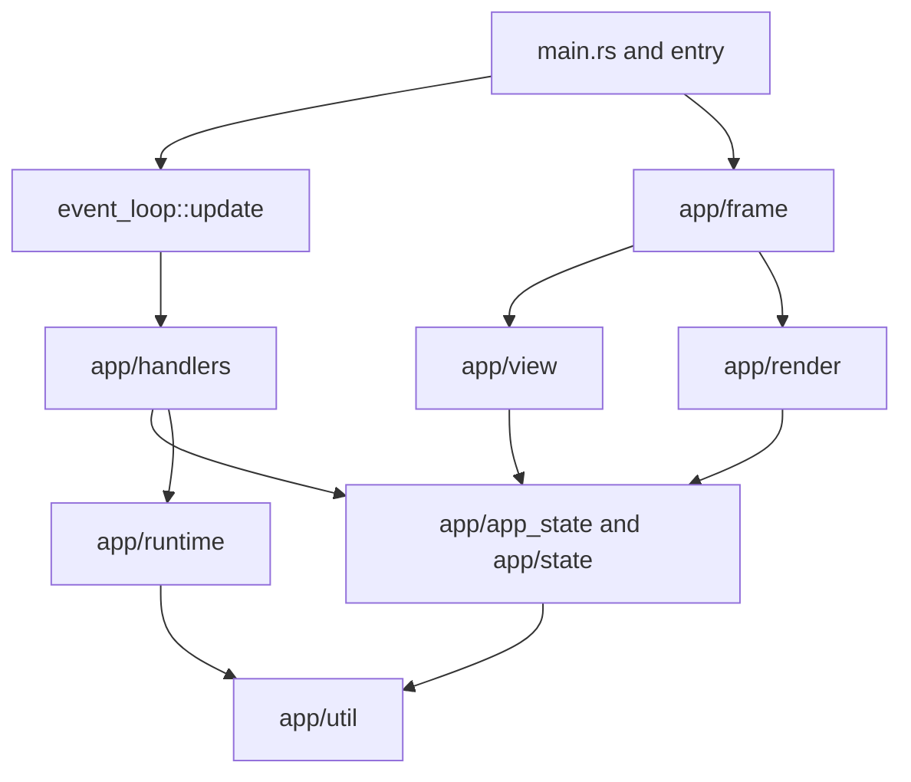

# TUI Architecture Spec

Status: `Implemented`

`crates/tui` is a Ratatui client using The Elm Architecture (TEA). `AppState`
is the model. Terminal input, runtime messages, local updates and ticks enter
`event_loop::update`. The entry loop executes local effects and calls the
bounded frame renderer. See [TUI TEA architecture](./tui-tea-architecture.md)
for the exact message contracts, tick order and verification commands.

## 1. Responsibilities and dependencies

| Layer | Modules and ownership |
| :--- | :--- |
| Entry | `main.rs` and `entry/` compose launch context, runtime and terminal lifecycles. `entry/run_loop.rs` owns event polling, child monitoring, effect execution and draw scheduling. |
| Application | `event_loop/update.rs` dispatches typed messages to input and feature handlers. `app/handlers/runtime_response/` applies runtime notifications and routes RPC responses. |
| Drawing | `app/frame.rs` composes `app/view/` with `app/render/inline.rs`. It bounds the draw, insertion and viewport-restoration cycle before input polling. |
| State and adapters | `app/app_state/` owns `AppState` and pending RPCs. `app/state/` owns shared model types and pure transitions. `app/runtime/` owns the RPC client and parser. |
| Shared modules | `app/theme.rs`, `markdown/`, `log_wrap.rs` and `transcript.rs` supply presentation and source projection. `app/util/` supplies low-level text, image, attachment and clipboard helpers. |

`RuntimeTx` carries synchronous RPC writes and request ID allocation from the
entry loop to application handlers, so the handler can apply its own send-failure
rollback. Terminal and worker effects are typed data in `app/effect.rs`. The
production import test guards the one-way boundaries between entry, update,
handlers, view, render, state and utilities.

## 2. Update and draw cycle

Each tick applies runtime lines individually, processes local completions and
pre-draw work, synchronizes mouse capture, and draws if needed. A pending
runtime confirmation promotes after its first frame and is painted before the
loop polls another key. The runner then polls input, executes resulting
effects, and runs the post-input tick when the input path permits it.

Entry selects Ratatui `Viewport::Inline` for inline mode.
`app/frame.rs` coordinates native scrollback through `Terminal::insert_before`. Alternate mode keeps the transcript within
the fullscreen viewport. `draw_ui` mutates the render cache and viewport
bookkeeping needed for both modes. See [render state machine](./tui-render-state-machine.md).

## 3. Live output

`state/stream_preview.rs` retains complete attempt/run-scoped text and reasoning
segments plus their display-row identities. `app_state/streaming.rs` batches
Markdown rendering into the normal display log before a draw/handoff/reset;
`transcript.rs` supplies shared body presentation and the stable source prefix.
Completed lines and stable paragraph graphemes enter native scrollback during
generation. Both view insertion scheduling and `render/inline.rs` fence only the
mutable Markdown tail, rather than withholding the full response until completion.
Canonical events confirm matching live rows without duplicate append; observed
attempt text survives retry/cancel. Streamed completion duration uses the existing
run line so handoff does not add a transcript footer. See the live output contract
in [ui-protocol.md](ui-protocol.md).
