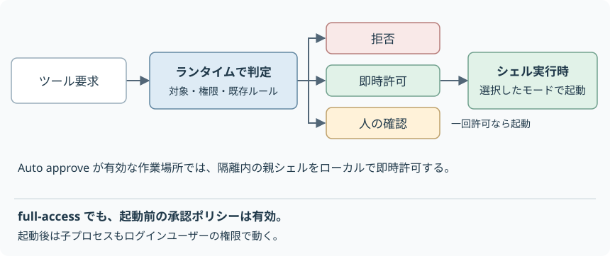

# サンドボックスとコマンド承認

[English guide](./command-approval.md)

Codelia では、**コマンドが起動した後にできること**をサンドボックスで選び、**そのコマンドを起動してよいか**を承認ポリシーで決める。通常起動は `workspace-write` と明示確認の組み合わせ。旧 `trusted` を設定していたプロジェクトもこの範囲で起動する。



## サンドボックスを選ぶ

| モード | シェルとその子プロセスの実効範囲 |
| --- | --- |
| `readonly` | 通常のローカルファイルを参照できる。作業ツリーは読み取り専用。実行用の一時領域を利用できる。直接通信は遮断 |
| `workspace-write`（旧 `trusted`） | 指定した作業ツリーと一時領域に書き込める。通常のローカルファイルはツリー外も参照できる。Codelia の認証・権限設定への書き込みと、外部への直接通信を制限する |
| `full-access` | **OS サンドボックスを外す。** 起動したシェルと子孫はログインユーザーのファイル・ネットワーク権限で動く。認証ファイルや Codelia の設定にもアクセスし得る。管理者への昇格は行わない。起動前には選択した承認ポリシーを適用する |

```sh
codelia --sandbox-mode readonly
codelia --sandbox-mode workspace-write
codelia --sandbox-mode full-access
```

### 1 コマンドだけサンドボックスの外で実行する

`readonly` と `workspace-write` の隔離シェルは直接通信できず、認証エージェントなどホストのサービスにも接続できず、作業ツリーの外には書き込めない。そのため `gh` のように通信やログイン状態が必要なコマンドは隔離内では失敗する。そのような失敗のあと、エージェントは同じ手順を `escalation: "unsandboxed"` 付きで依頼できる。承認されると、そのコマンドと子孫だけがログインユーザーとして、ユーザーのファイル・認証情報・環境変数・通信を使って動く。次のコマンドには元のサンドボックスが適用される。

昇格は毎回その場で判断し、保存しない。保存済みのコマンド許可、手書きの許可、ワークスペースの Auto approve による自動起動、Auto Review のどれでも通らない。毎回人が **Approve unsandboxed shell?** ダイアログの **Run once (unsandboxed)** で判断する。拒否ルールは先に適用する。子エージェント、対話的な stdin、`additional_write_roots` との併用、独自のシェル基盤・承認アダプターや運用者の非公開パスを持つ SDK ホストからは昇格できない。昇格が使える環境では、隔離内で失敗したコマンドの結果に実行したサンドボックスが示され、エージェントが昇格の要否を判断できる。

作業ツリーはライブ編集される。テストが途中で失敗しても、それまでに書いた変更は残り得る。`workspace-write` で既存の通常ファイルのハードリンクを直接編集すると、ツリー外の別名からも変更が見える。読み取り専用モードでソースの変更を要求した場合は、ユーザーがコマンドを承認しても、そのモードの書き込み制限が適用される。

組み込みの編集ツールからは、作業ツリーの Git 管理データと `.codelia/` を読み取り専用にする。隔離シェルでは `.codelia/` は読み取り専用のまま、`workspace-write` の開発用コマンドに限り通常のローカル Git 操作（`git add`、`commit`、`switch`、`stash`、`rebase` など）ができる。Git ディレクトリ（linked worktree ではそのメタデータと作業ツリー外の共通ディレクトリ）が書き込み可能になる。ただし、後でサンドボックス外の Git に別の場所を参照させたりコードを実行させたりできる項目は、まだ存在しないものも含めて読み取り専用のまま残す。対象は `config`、`config.worktree`、`hooks/`、`commondir`、`gitdir`、`objects/info/alternates`、`remotes/`、`branches/`、`modules/`、既存の linked worktree の参照ファイル、linked worktree 自身の `.git` ファイル。これらへの書き込みが必要な操作（設定変更、`git push -u`、上流ブランチの設定、サブモジュール）、通信を伴う Git 操作、エージェントのソケットを使うコミット署名には昇格が要る。ブランチや履歴はサンドボックスでは守られず、隔離内のコマンドでも ref を移動・削除できる。Linux の bind mount はまだ存在しない名前を予約できないため、コマンドが作った保護対象の項目は終了時に削除してログに残す。隔離シェルは TTY が必要なテスト向けに疑似端末を確保できる。macOS では隔離内で作った端末だけを読み書きでき、既存の端末には制御呼び出しだけを許す。隔離シェルの HOME はログインユーザーのもの（既存の許可の外は読み取り専用）で、`TMPDIR` と `XDG_CACHE_HOME` は専用の一時領域。Codelia 本体は管理操作に必要な状態を保存できる。Codelia 自身の認証ファイルも、非公開に指定しなければ OS がユーザーに許す範囲で読める。

### 読ませたくないファイルを指定する

ローカルの通常ファイルはプロジェクト外も含めて原則読み取り可。ワークスペースの `.env` も、ホームにある各種ツールの設定も、名前を理由に一律に隠すことはない。隔離時に読ませたくないファイル・ディレクトリはユーザー所有の `projects.json` に絶対パスで指定する。たとえば次の設定は一つのディレクトリを全プロジェクトで非公開にする。

```json
{
  "version": 1,
  "default": {
    "protected_paths": ["/example/private"]
  }
}
```

`/example/private` は実際に保護する絶対パスに置き換える。プロジェクト単位の指定は同じファイルの `projects["ワークスペースの絶対パス"].protected_paths` に加える。全体・プロジェクト・SDK ホストの指定は合算する。手で編集した後はローカル runtime を再起動して適用する。明示した `full-access` のシェルは、ローカル設定の非公開パスも含め OS 隔離を外す。SDK ホストが必須とした非公開パスは別途強制できる必要がある。ユーザー所有の設定を確認できないホストでは、そのワークスペースに適用する非公開パスがあればエラーになる。[projects.json の格納場所](../dev-docs/specs/storage-layout.md)

ホーム自体を作業場所にした場合、`workspace-write` では通常のファイルやディレクトリ（`~/Desktop`・`~/workspace` など）への書き込みを維持しつつ（Linux gVisor ではホーム直下自体は読み取り専用マウントとし、既存の通常子エントリを書き込み可能に bind するため、Linux のみ `~` 直下への新規エントリ作成には既存のサブディレクトリが必要）、直下のドットエントリ（`~/.*`、既存・新規とも）および macOS の `~/Library` は隔離シェル・組み込みファイルツールの双方で既定読み取り専用として保護する（シェル設定や `~/.npm-global`・`~/.bun`・`~/.nvm`・`~/Library/pnpm` 等のグローバルストアを含む）。組み込みの `write`/`edit` ツールはホーム直下のドットエントリを常に拒否し、シェルコマンドから既存の外部ディレクトリやホーム直下のドットディレクトリへ書き込む場合は `additional_write_roots`（既存ディレクトリ単位であり、`~/.zshrc` のような単一ファイル指定は非対象）で追加承認を求める。所有者と既定の保存先を確認できたユーザー設定からモードや非公開パスを読み込み、Auto approve やツール記憶、サンドボックスモードの変更もホーム用のワークスペース設定として保存できる（シンボリックリンクによるリダイレクトや不正な権限、別チェックアウト内の設定は拒否する）。また、プロジェクト側の `.codelia/config.json` がグローバルの `config.json` と同一ファイルを指す場合は、`global` として一度だけ読み込み、設定変更時は `global` スコープの明示を求める。

Linux の隔離シェルからホーム直下の通常のシンボリックリンクを辿って書き込む際は、リンク先の権限が適用される。リンク先が書き込み可能なワークスペース内なら追加承認は不要で、外部ディレクトリならリンク先の追加承認が必要になる。保護対象への制限も維持される。ホーム直下のドットリンクが存在しないパスを指す場合は、特定できた作成予定先も保護する。ホーム直下の保護対象だけで完結する循環リンクがあっても、通常のワークスペース書き込みは続行できる。保護リンクの解決もこの種の循環の確認もできない場合は、書き込み権限を必要とする操作が止まることがある。

### 開発ツールを見つける仕組み

Codelia を起動した環境の `PATH` をコマンドに渡す。SDK ホストは `RuntimeHostAdapters.shellPath` を指定できる。実行ファイルを固定できない場合や、`direnv` や `nix develop` で `PATH` が変わった場合は、保存済みルールの再確認が必要になる。OS 標準の場所に解決しない Homebrew や Nix のコマンドは通常の承認経路を使う。POSIX の隔離シェルは専用 HOME を使い、既存の `CARGO_HOME` と `RUSTUP_HOME` は同じファイル境界の下で参照できる。未設定なら起動元のホームにある既定のディレクトリを探す。`full-access` も明示された既存の絶対パスを引き継ぐ。未設定時は Rust がログインユーザーの HOME を使う。Cargo のオフラインビルドにはローカルの依存キャッシュが必要で、キャッシュ更新が必要な操作には書き込み可能な場所を指定する。

### OS ごとの実行基盤

| ホスト | 隔離モード（`readonly` / `workspace-write`） |
| --- | --- |
| macOS | 既定は Seatbelt。arm64 では `CODELIA_MAC_SHELL_BACKEND=mxc codelia` で、同じポリシーを MXC の Rust ヘルパー経由で適用できる |
| Linux | rootless の gVisor `runsc bwrap` を検査する。保護パスが存在する特定の構成で動作を確認。未作成の保護パスを含む通常の構成や、必要な分離を提供できないホストでは起動を拒否する |
| Windows | ネイティブの MXC ProcessContainer を評価中。Codelia が要求する許可に加え、Windows が既存 ACL で許すファイルや IPC がある。実機で確認済みの標準構成がない間は、対応する SDK バックエンドが必要。ローカル TUI は利用できない理由を表示する |

macOS の標準ローカル `workspace-write` では、Git オブジェクトを共有する clone でもソースを編集し、開発シェルでテストできる。Git 管理パスは読み取り専用。共有された Git ファイル自体をシェルから既存の書き込み可能な別名で編集すると、元リポジトリにも影響する。組み込みの編集ツールは書き込み先が Git 管理データの別名なら拒否する。Linux・Windows の隔離下で新規作成・移動・削除を使うには、それぞれ対応する実行基盤が必要になる。

ローカルで MXC を選ぶには、エージェントが編集できる作業ツリーの外にヘルパーをインストールする。CLI のグローバルインストールがその一例。ツリー内の依存パッケージとしてしか見つからない場合、隔離シェルは起動前に停止する。明示した `full-access` ではローカルシェルをユーザー権限で起動する。[Windows の実機評価手順と対応状況](../dev-docs/specs/windows-mxc-qualification.md)・[Windows MXC のポリシー仕様](https://github.com/microsoft/mxc/blob/v1.1.0/docs/schema.md)

## コマンドの承認方式を選ぶ

| 承認方式 | 既存の許可に一致する操作 | 新しく要求された操作 |
| --- | --- | --- |
| 明示確認（既定） | ローカルで決定 | 起動内容を人に示して確認する。確認 UI のないクライアントでは `confirmation_required` になる場合がある |
| Auto approve（自動承認） | ローカルで決定 | 強制ルールを通れば、ローカルの親エージェントが現在の隔離内で一度起動する。確認とモデル呼び出しは発生しない |

`/auto-approve` の **Enable in this workspace** で、このワークスペースの自動起動を有効にする。必要なら同じ画面でチャット provider への追随やモデルの固定も選べる。以前の全体設定に保存したモデルは引き継ぐ。自動起動はワークスペースごとに明示する。`/auto-approve status` で自動起動とモデルの状態を確認できる。`/auto-approve off` は現在のワークスペースを明示確認に戻す。

`readonly` と `workspace-write` の隔離内で、明示 deny とホスト上限を評価できる起動が対象。照合できない deny があれば起動前に拒否する。通信制限は起動後も適用する。ワークスペース外やホーム直下のドットディレクトリに対する `additional_write_roots` 要求（Codelia の設定・認証ディレクトリ、実行中のインストールや MXC ランチャーと重なる範囲を除く）は、Auto approve の審査モデルが有効なら審査を経由し、無効または判定保留時は人への確認へフォールバックする。

ローカル TUI の `workspace-write` では、組み込み `apply_patch` の全対象が独立した通常の追加・更新で、既存の書き込み許可に収まれば、パッチを確認なしで適用できる。削除や移動を含む場合はパッチ全体を確認する。`dry_run` は読み取り権限でプレビューする。

### 一回の承認と保存できるルール

| エージェントの要求例 | ローカル TUI での扱い |
| --- | --- |
| `cargo test -p parser`、`npm run build`、ファイルを指定したテスト | Auto approve がオンで、現在の隔離と強制ルールを適用できれば、確認なしで一度起動する。サブディレクトリも対象 |
| `set -e; for f in a.txt b.txt; do wc -l "$f"; done` | 両ファイルへの操作が組み込みの参照許可を満たせば、確認もモデル呼び出しもゼロ。ループのキーワードは登録しない |
| `cargo test`、`npm run build`、`pytest -q` などの単純な外部コマンド | 実行ファイルと引数を確定できる隔離起動なら、利用者が確認画面でセッションまたはプロジェクトに保存できる。追加の権限を求める操作や、シェルの複合構文は対象外 |

明示確認で隔離シェルを起動する場合は、確認画面にコマンドと選択肢が出る。`D` で全文、審査理由、作業ディレクトリと権限を確認できる。**今回だけ実行**を選ぶと、その要求を元の権限で実行する。**今後の許可を設定**を選んだ時だけ、モデルに保存ルールの候補を求める。**見送る**と起動しない。

Auto approve がオフでも「今後の許可を設定」は使える。この場合は現在のチャットのプロバイダーを使い、自動承認はオフのままになる。Auto approve の送信先を指定している場合はその設定に従う。候補を作るために送るのは、コマンドの語列と今回の要求を識別する ID だけ。通常の自動審査で使う会話や作業ディレクトリは含めない。

たとえば `cargo test -p parser --release` に対して、モデルが `cargo test` と任意の後続引数を提案する場合がある。runtime が元の要求と照合したルールを次の画面に表示する。そこに表示された範囲と保存先を確認して初めて保存される。モデルから候補を取得できない場合も、単一コマンドを実行条件に結び付けて安全に保存できるなら、完全一致ルールを確認画面に出す。複合シェルは、人が許可できる要求なら今回限りで実行できる。

候補を作るモデルには、実行する操作を決める語まで残すように指示する。たとえば `npm run build -- --watch` なら、スクリプト名を含む `npm run build` までが候補になる。モデルが境界を特定できない場合は完全一致を提案する。保存前の確認画面で、許可する語列と作業ディレクトリを確認できる。

確認画面で `cargo test` と任意の後続引数を許可すると、同じプロジェクト・cwd・実行条件で `cargo test --release` や `cargo test parser` にも使える。`cargo build` は別に判断する。rustup の `cargo` など、ユーザーがインストールした実行ファイルに複数のハードリンクがあっても、書き込み・非公開範囲の外にある同じディレクトリで全リンクを確認できれば、保存ルールと手書きの allow が使える。別ディレクトリにもリンクがある場合や確認できない場合は、今回の実行を通常の承認経路で判断する。候補には許可する引数の範囲を表示する。完全一致で保存済みのルールは元の範囲を保つ。以前の Bun テスト・型検査専用ルールも、元の対象と現在の実行ファイルを照合できれば再利用する。実行ファイルや `PATH` が変われば保存済みルールを再確認する。テストやビルドスクリプトの内容は次回までに変わり得る。

TUI の `/permissions list` で保存済みルールを確認し、`/permissions remove` で取り消せる。`/permissions run cargo test` は利用者自身のコマンドとして承認後に一度実行する。その場で保存したルールは、利用者が同じ条件で起動するときに使える。エージェントの起動用ルールを保存するには、エージェントからの確認画面で保存を選ぶ。

シェル解析は Bash の一部に対応する。パイプ、条件分岐、リテラルの有限ループは全体を一度に扱う。隔離下の親エージェントは、強制ルールを適用できれば、一部しか解析できないシェルもその隔離内で起動する。既存の禁止ルールを評価できなければ起動を止める。追加権限の付与は専用の確認画面で人が決める。`full-access` でモデルに委任できるのは `uname -s` のような限定された単純操作。ビルドスクリプトは人に確認し、起動後はログインユーザーの権限で動く。

### 手書きした許可を使う

次の `config.json` は、単独で実行する `cargo test` とその後続引数、および組み込みの `webfetch` に許可を与える。既存の同じ形式をそのまま使える。

```json
{
  "version": 1,
  "permissions": {
    "allow": [
      { "tool": "shell", "command": "cargo test" },
      { "tool": "webfetch" }
    ]
  }
}
```

| 保存場所・設定 | いつ有効になるか |
| --- | --- |
| ユーザーの `~/.codelia/config.json`（または設定した個人用パス） | ローカル runtime がユーザー所有の設定として検証して読み込んだとき |
| 共有の `.codelia/config.json`、旧 `trusted` 適用済み | 以前の明示設定の範囲でそのまま有効。追加の確認は不要 |
| 共有の `.codelia/config.json`、新しいプロジェクト | `/permissions trust` でルールと対象フォルダを確認すると有効。以後は同じプロジェクトのルール変更にも適用する |
| 共有の許可を取り消したい | `/permissions untrust` で停止する。旧 `trusted` を残していても取り消しが優先する |

`/permissions list` で信頼状態とルールを確認できる。`command` はコマンドの語列を先頭から照合するため、`cargo testcase` は例のルールに一致しない。`command_glob` ではパターンを指定できる。複合シェル全体や別の書き込み先への許可は個別に判断する。禁止ルールは共有設定の信頼前も有効。ユーザー所有のポリシーを検証して書き込める環境では、TUI から信頼を変更できる。Windows のローカル runtime は現在、状態の表示に対応する。

### ツールごとの「今後も許可」

`webfetch` など、ツールの起動だけを確認する場面では、確認画面でこのワークスペースについての許可を保存できる。個人の `projects.json` の `projects[プロジェクトの実体パス].remembered_tool_allows` に、たとえば `[{"tool":"webfetch"}]` として記録する。共有設定の信頼は必要なく、他の利用者の設定にも影響しない。`/permissions list` で一覧を確認し、`/permissions remove` で一件ずつ取り消せる。

`image_export` は出力先の書き込み権限も照合する。すでに許可された範囲ならそのまま保存できる。`image_generate` と `decision` の課金を伴う呼び出しは人に確認する。スキルの読み込みは通常そのまま通り、`skill_name` を指定した禁止は対象のスキルだけに適用される。

## 旧設定からの移行

| 旧モード | 読み込み時の扱い |
| --- | --- |
| `minimal` | `readonly` |
| `trusted` | `workspace-write`。以前に信頼した範囲で共有 `permissions.allow` も有効になる |
| `full-access` | `workspace-write` で起動し、新しい指定方法を案内する。OS 隔離を外す場合は `--sandbox-mode full-access` などで明示する |
| 未設定 | `workspace-write` |

選択の優先順位は **CLI → 環境変数 → プロジェクト個別値 → 全体既定 → 組み込み既定**。同じ層に旧指定と新指定があれば新指定を使う。CLI や環境変数の指定を変えるには再起動する。対応する GUI は、上位の指定がないとき、アイドル中にそのワークスペースの設定を変更できる。次の run から有効になる。

- 旧 `--approval-mode trusted` や `CODELIA_APPROVAL_MODE=trusted` を指定していた起動では、その起動中の共有 allow も有効になる。新しい `--sandbox-mode workspace-write` だけに変更した場合は、必要なプロジェクトで一度 `/permissions trust` を選ぶ。
- ユーザーの `projects.json` は `projects["<プロジェクトの実体パス>"].sandbox_mode` または `default.sandbox_mode` を使う。標準は `~/.codelia/projects.json`。XDG レイアウトでは `$XDG_CONFIG_HOME/codelia/projects.json`、未指定時は `~/.config/codelia/projects.json`。リポジトリ内の設定からこの権限を引き上げることはできない。
- 例として、全体既定が旧 `minimal` でも、対象プロジェクトの旧 `trusted` が優先されて `workspace-write` になる。そのプロジェクトに新旧両方の値を残して `sandbox_mode: "readonly"` と指定すると、`readonly` を選ぶ。
- 旧 `permissions.allow` と `permissions.deny` は設定ファイルに残したまま使用できる。新しい `workspace-write` を単独で選んだ場合は、共有設定の信頼をユーザーが選ぶ。以前のテスト専用 Auto approve は、対象が広がるため設定を選び直す。

## 止まったときの見分け方

| 状況 | 確認する点 |
| --- | --- |
| `readonly` で編集が拒否される | 必要な作業範囲を確認し、書き込みが必要なら `workspace-write` で起動する |
| `sandbox_unavailable` | 選択したバックエンドが必要な保護を提供できない。対応する OS と実行基盤を確認する。隔離できない場合に自動で `full-access` に切り替えることはない |
| macOS の隔離内で通常ファイルは読めるが `git status` が失敗する | 通常のリポジトリと linked worktree では管理データを読み取り専用にして status／diff を実行できる。別途指定した非公開パスや壊れた Git 管理パスを確認する |
| テストや実装レビューを依頼した | Auto approve をオンにしたワークスペースでは、現在の隔離内で条件を満たすローカルテストを起動する |
| Auto approve を選んだのに確認画面が開く | 現在のワークスペースの設定、実効モード、追加の書き込み先や stdin などを確認する。選択したモデルの認証状態は、隔離内の自動起動とは独立して表示する |
| 審査のエラーが返り、確認画面が開かない | 有効な対話 UI があるか、要求が失効していないかを確認する。強制ルールによる拒否はその場で終了する。対話できない経路ではコマンドは未実行で、通信失敗・応答形式などの診断が返る。ファイル調査なら `read` や `read_line` で続けられる |
| `legacy_deny_rule` または `deny_rule_unverifiable` | 前者は明示した禁止に一致した。後者は、そのシェルに適用される禁止ルールを評価しきれなかった。いずれも起動前に止まる |
| 明示した旧 `trusted` だけを理由に `legacy_approval_mode (project)` になる | これは改修途中の旧 runtime の挙動。実際に TUI が起動している runtime と起動引数を確認する |

[実行基盤と承認の設計仕様](../dev-docs/specs/command-approval-and-auto-review.md)・[provider と送信データ](./command-approval.md)
